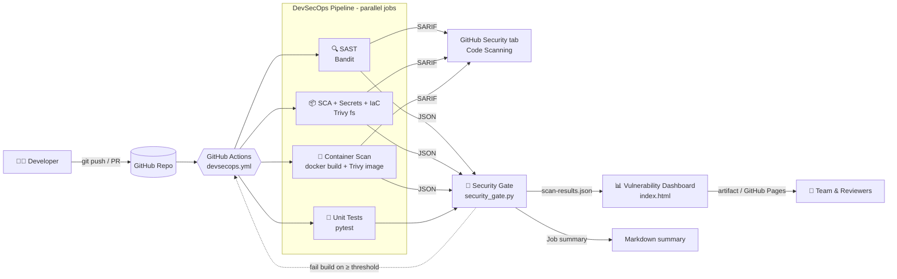

# 🛡️ Automated Cloud-Native DevSecOps Pipeline & Vulnerability Dashboard

[](https://github.com/ghaadii99aa-create/devsecops-pipeline-dashboard-/actions/workflows/devsecops.yml)


[](LICENSE)

A production-style **shift-left security** reference project. Every `push` and `pull_request` triggers a
GitHub Actions pipeline that tests a containerised Flask service, runs **static analysis (Bandit)**,
**dependency, secret and IaC scanning (Trivy)** and a **container image scan (Trivy)**, enforces a
configurable **security gate**, and publishes the results to an interactive **vulnerability dashboard**
that groups findings into **Critical / High / Medium / Low** cards.

---

## 📐 Architecture Overview



| Stage | Tool | What it catches | Output |
|---|---|---|---|
| Unit tests | `pytest` | Functional regressions, missing security headers, input-validation bypasses | Test report |
| SAST | **Bandit** | Insecure Python patterns (`debug=True`, `shell=True`, weak crypto, hard-coded binds…) | JSON + SARIF |
| SCA | **Trivy fs** | Known CVEs in `requirements.txt` dependencies | JSON + SARIF |
| Secret scanning | **Trivy fs** | API keys, tokens, private keys committed to the repo | JSON + SARIF |
| IaC / misconfig | **Trivy fs** | Dockerfile anti-patterns (root user, no healthcheck, `latest` tags…) | JSON + SARIF |
| Container scan | **Trivy image** | Fixable OS & library CVEs in the built image | JSON + SARIF |
| Security gate | `scripts/security_gate.py` | Merges every report, writes the job summary, fails on policy breach | `scan-results.json` |
| Dashboard | `index.html` | Visualises findings by severity, scanner and category | Artifact / GitHub Pages |

---

## ✨ Key Features

- **Automated on every change** – runs on every push, pull request, manual dispatch and a weekly schedule (to catch newly published CVEs).
- **Layered scanning** – SAST, SCA, secret detection, IaC misconfiguration and container image scanning in parallel jobs.
- **Policy-as-code security gate** – fails the build on findings at or above a configurable severity (`CRITICAL` by default; choose `HIGH`, `MEDIUM`, `LOW` or `NONE` from *Run workflow*). It also fails closed when no scan evidence is present.
- **GitHub-native reporting** – SARIF uploads surface findings in the **Security → Code scanning** tab and as PR annotations; a Markdown summary is posted on every run.
- **Interactive vulnerability dashboard** – severity cards (Critical / High / Medium / Low), risk score, breakdown by scanner and category, search and filters, links to advisories and remediation advice. Drag-and-drop raw Bandit/Trivy JSON to analyse reports locally; nothing leaves the browser.
- **Hardened pipeline** – least-privilege `GITHUB_TOKEN` permissions, every action pinned to a full commit SHA, `persist-credentials: false`, concurrency control, and fork-safe SARIF uploads.
- **Secure-by-default application** – no debug mode, no hard-coded secrets, strict input validation, request-size limits, and hardened HTTP headers (CSP, HSTS, X-Frame-Options, …).
- **Hardened container** – multi-stage build, non-root user, `HEALTHCHECK`, pip removed from the runtime image, Gunicorn as the production server.

---

## 📁 Project Structure

```
.
├── .github/workflows/devsecops.yml   # CI/CD pipeline: tests, Bandit, Trivy, gate, dashboard
├── app.py                            # Flask application (scan target)
├── requirements.txt                  # Pinned runtime dependencies
├── requirements-dev.txt              # Test & security tooling
├── Dockerfile                        # Hardened multi-stage container image
├── index.html                        # Vulnerability dashboard (HTML/CSS/JS, no dependencies)
├── scripts/security_gate.py          # Report normalizer + security gate
├── tests/test_app.py                 # Unit & security regression tests
└── reports/                          # Local scan output (git-ignored)
```

---

## 🚀 Setup Instructions

### Prerequisites

- Python **3.13+**
- [Docker](https://docs.docker.com/get-docker/) (optional, for the container image)
- [Trivy](https://trivy.dev/latest/getting-started/installation/) (optional, for local scanning)

### 1. Clone and install

```bash
git clone https://github.com/ghaadii99aa-create/devsecops-pipeline-dashboard-.git
cd devsecops-pipeline-dashboard-
python -m venv .venv && source .venv/bin/activate   # Windows: .venv\Scripts\activate
pip install -r requirements-dev.txt
```

### 2. Run the application

```bash
python app.py                     # http://127.0.0.1:5000
curl http://127.0.0.1:5000/health
curl "http://127.0.0.1:5000/api/greet?name=Ada"
```

Or in a container:

```bash
docker build -t secureship-demo-api .
docker run --rm -p 8080:8080 -e SECRET_KEY="$(openssl rand -hex 32)" secureship-demo-api
```

### 3. Run tests and security scans locally

```bash
pytest -v

mkdir -p scan-reports
bandit -r . -x ./tests,./.venv -f json -o scan-reports/bandit-report.json --exit-zero
trivy fs --scanners vuln,secret,misconfig --format json -o scan-reports/trivy-fs-report.json .
trivy image --ignore-unfixed --format json -o scan-reports/trivy-image-report.json secureship-demo-api

python scripts/security_gate.py --input-dir scan-reports --output reports/scan-results.json --fail-on CRITICAL
```

### 4. Open the dashboard

```bash
python -m http.server 8000        # then open http://localhost:8000
```

The dashboard automatically loads `reports/scan-results.json`. If it is missing, it shows demo data; you can also
click **Load reports** (or drag & drop) to open any `bandit-report.json`, `trivy-*-report.json` or `scan-results.json`.

### 5. Enable it on GitHub

1. Push the repository – the **DevSecOps Pipeline** workflow starts automatically.
2. Open **Actions → DevSecOps Pipeline → (run)** to see the security summary, and download the
   `security-dashboard` artifact for the full interactive report.
3. *(Optional)* Publish the dashboard to **GitHub Pages**:
   - **Settings → Pages → Source:** `GitHub Actions`
   - **Settings → Secrets and variables → Actions → Variables:** add `ENABLE_PAGES` = `true`
   - The next push to the default branch deploys the dashboard to `https://<user>.github.io/<repo>/`.
4. *(Optional)* Protect `main` with **Settings → Branches → Require status checks** and select
   **Security Gate & Dashboard** so vulnerable code cannot be merged.

> **Note:** SARIF upload to the Security tab is available for public repositories, or private repositories with
> GitHub Advanced Security. On other repositories that step is skipped gracefully and the dashboard still works.

---

## ⚙️ Configuration

| Setting | Where | Default | Description |
|---|---|---|---|
| `FAIL_ON` | Workflow input / env | `CRITICAL` | Lowest severity that fails the gate (`CRITICAL`, `HIGH`, `MEDIUM`, `LOW`, `NONE`). |
| `ENABLE_PAGES` | Repository variable | unset | Set to `true` to deploy the dashboard to GitHub Pages. |
| `SECRET_KEY` | Runtime env | random per process | Flask secret key; inject from a secret manager in production. |
| `APP_ENV` / `APP_VERSION` | Runtime env | `development` / `1.0.0` | Reported by `/api/info`. |
| `HOST` / `PORT` | Runtime env | `127.0.0.1` / `5000` | Dev-server bind address (the container uses Gunicorn on `0.0.0.0:8080`). |

---

## 🗺️ Roadmap

- [ ] SBOM generation (CycloneDX) and image signing with Sigstore Cosign
- [ ] DAST stage with OWASP ZAP against the running container
- [ ] Kubernetes manifests with Trivy/Kubescape policy checks
- [ ] Trend history across pipeline runs in the dashboard

---

## 📄 License

Released under the [MIT License](LICENSE).
